# Zepprz | Cab Booking Demo & AWS Infrastructure

Zepprz is a responsive cab-booking **front-end prototype** packaged with Docker and a Terraform-defined AWS deployment architecture. This project demonstrates how a web application can be containerized and prepared for a multi-AZ AWS environment with edge protection, private application networking, managed data services, and operational monitoring.

> **Project status:** The browser app is a local demo, not a live ride-hailing service. It has no production API, authentication, payment processing, or backend integration. The AWS infrastructure shown here was deployed for evaluation and has since been destroyed. There is no live AWS application endpoint; the architecture image documents the intended design.

## Historical AWS deployment screenshots

These AWS Console screenshots were captured on November 2, 2026, during a temporary deployment. They document resources that have since been destroyed; AWS account IDs, ARNs, VPC/subnet IDs, and service endpoints have been redacted for this public repository.

### ECS Fargate

At capture time, the ECS cluster had two running tasks and Container Insights enabled.

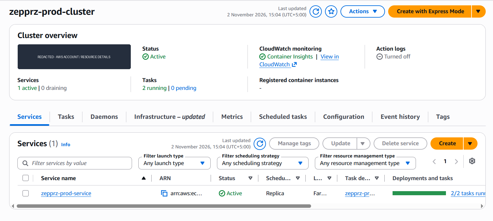

### Application Load Balancer

At capture time, the internet-facing ALB spanned two Availability Zones. Its origin access was restricted; it was not a public application URL.

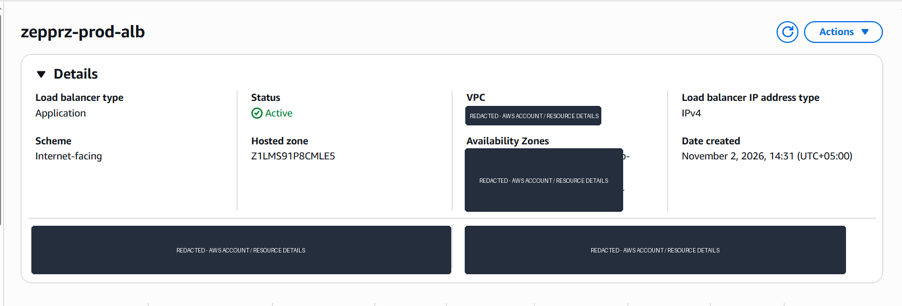

The ALB target group reported two healthy targets at capture time.

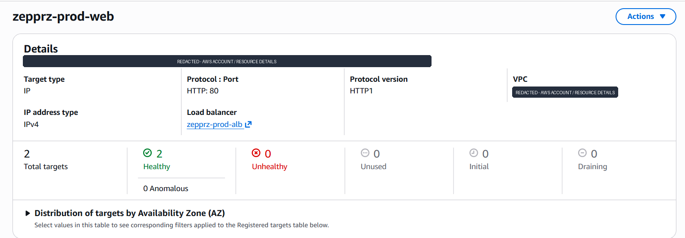

### Managed data services

The PostgreSQL RDS instance was available. The application demo did not connect to this database.

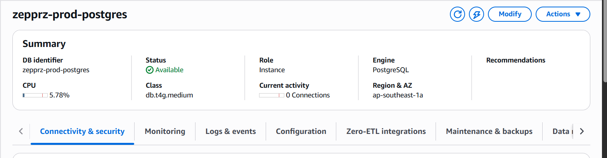

The Redis replication group had two nodes, Multi-AZ failover, and encryption enabled. The browser demo did not connect to Redis.

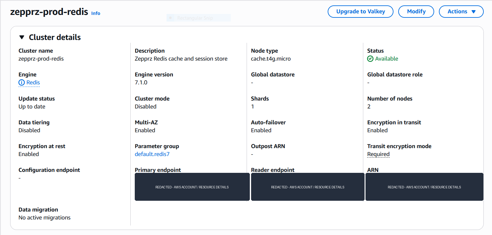

### Networking and image registry

The VPC resource map showed public, application, and data subnets across two Availability Zones, with separate NAT Gateways.

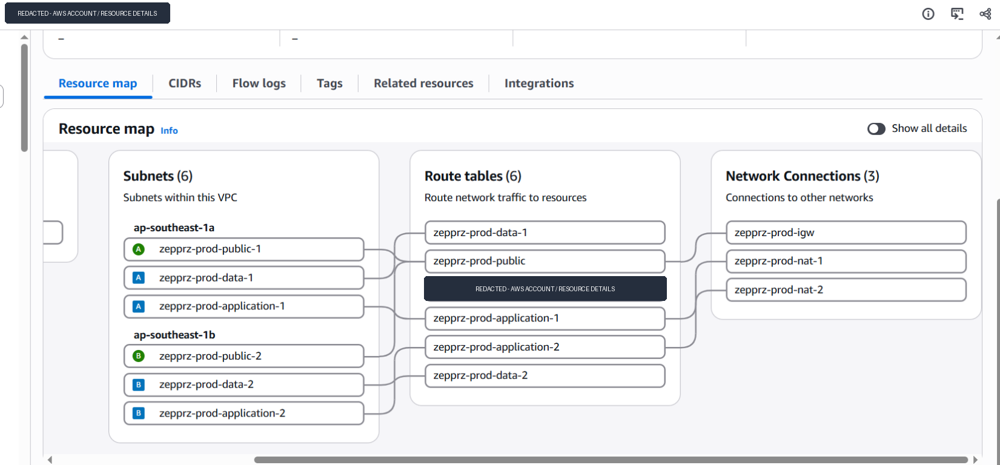

The Nginx application image was pushed to a private ECR repository.

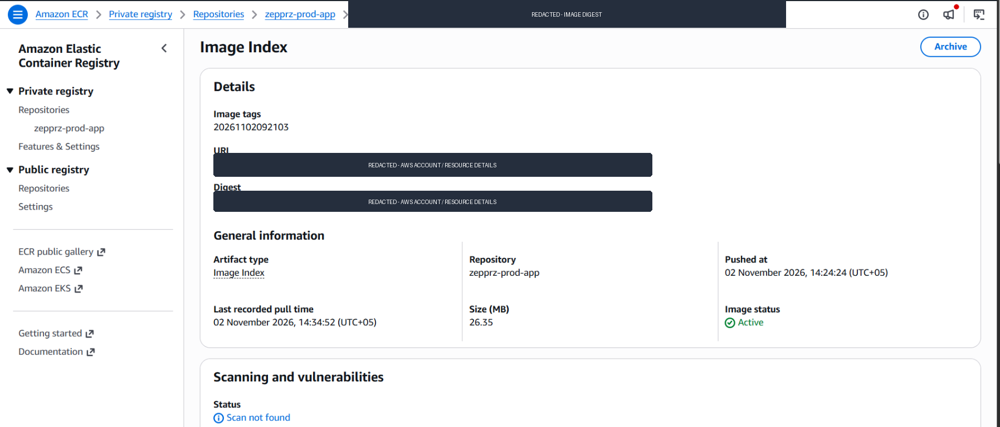

### Monitoring and edge protection

CloudWatch showed the configured infrastructure alarms in an OK state at capture time.

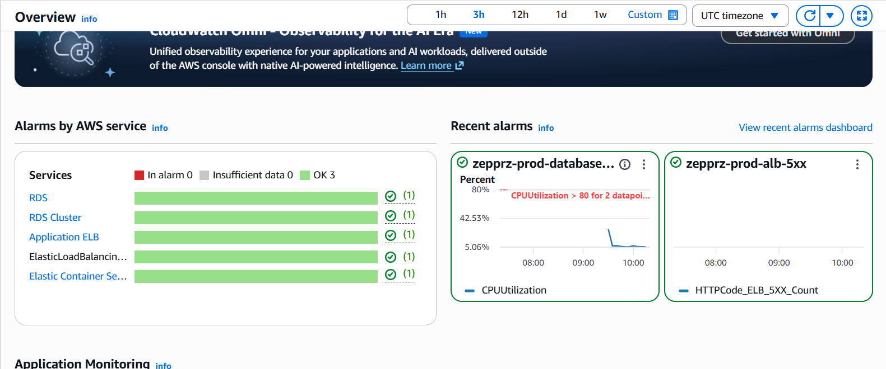

The AWS WAF web ACL and traffic overview were configured. The screenshot does not prove that the ACL was attached to a CloudFront distribution.

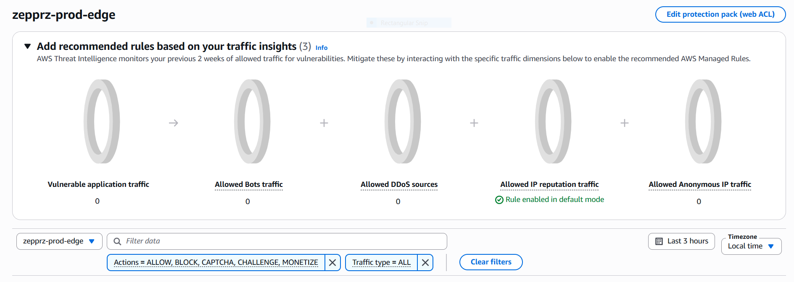

**Deployment note:** These images are historical evidence of a temporary infrastructure deployment, not current AWS resources. CloudFront was not created, so the app was never publicly available through CloudFront.

## What the app demonstrates

- Rider, driver, and admin-demo workspaces.
- Ride request flow, fare estimate, illustrative route preview, ride status changes, driver availability, and booking history.
- Browser `localStorage` persistence for sample bookings.
- Responsive interface served by Nginx in a Docker container.

All rides, driver details, and fares are illustrative. No real location tracking, accounts, dispatch, or payments are implemented.

### Website preview

The screenshot below shows the local browser prototype. It is not a live production website.

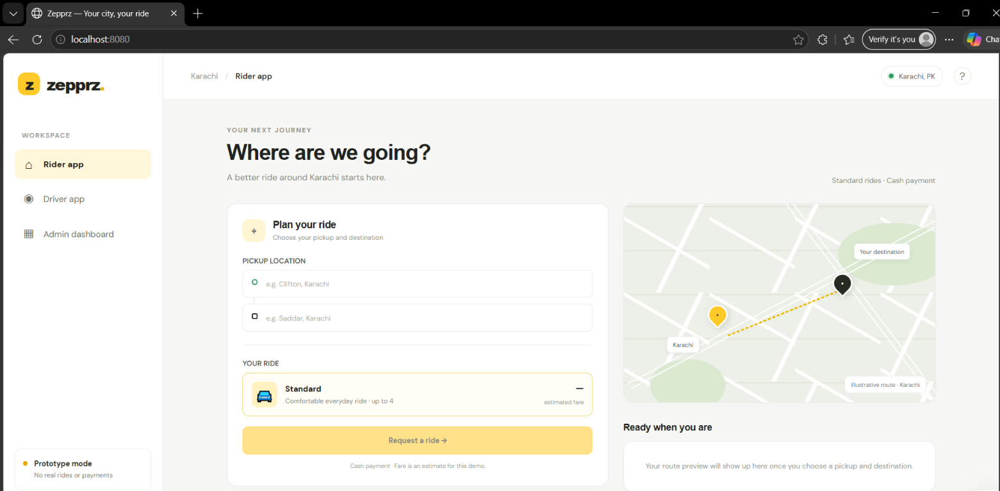

## Architecture

The diagram below shows the intended AWS architecture. It is a design reference; the AWS resources in the diagram are not currently deployed.

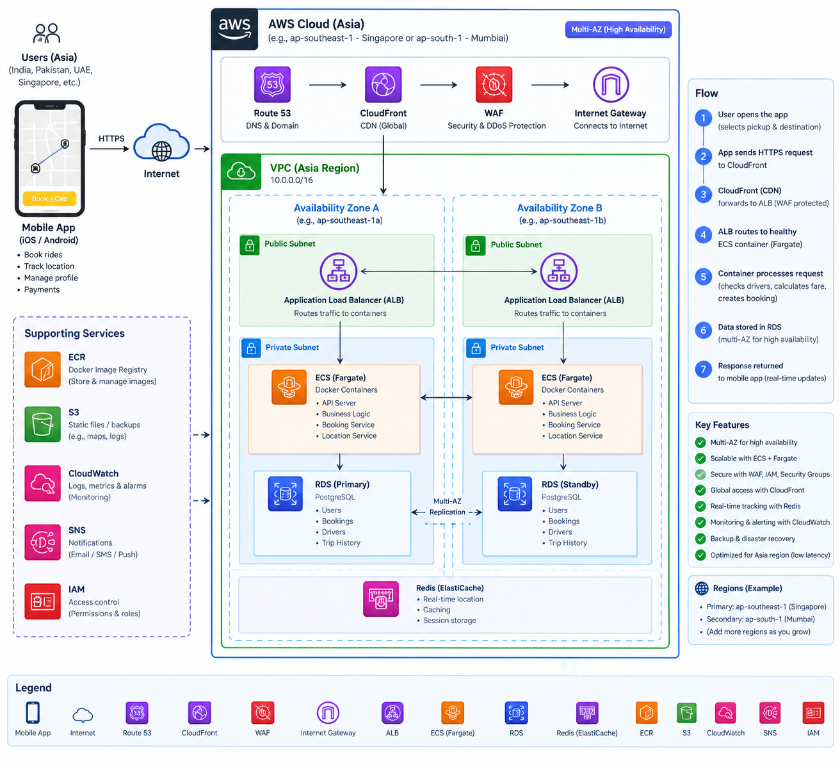

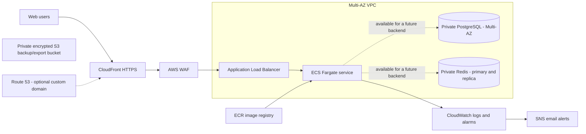

### AWS components

| Area | Services | Purpose |
|---|---|---|
| Edge and DNS | CloudFront, AWS WAF, optional Route 53 | HTTPS delivery, managed WAF rules, IP rate limiting, optional custom domain |
| Networking | VPC, public/application/data subnets across Availability Zones, Internet Gateway, per-AZ NAT Gateways | Separate public load-balancer, private task, and isolated data tiers |
| Container platform | ECR, ECS Fargate, Application Load Balancer | Store and run the Nginx image and route requests to healthy tasks |
| Data services | Multi-AZ RDS PostgreSQL, Redis replication group | Managed data/cache services reserved for a future backend |
| Operations | CloudWatch logs and alarms, SNS, encrypted/versioned S3 bucket | Basic monitoring, email notifications, and a private location for future exports |

**Important:** PostgreSQL and Redis are infrastructure placeholders: the current browser-only app does not connect to either service. The S3 bucket is not used by the demo frontend.

## Technology

- HTML, CSS, vanilla JavaScript
- Docker and Nginx
- Terraform, AWS provider, and AWS CLI
- AWS ECS Fargate, ECR, ALB, CloudFront, WAF, VPC, RDS, ElastiCache, S3, CloudWatch, SNS, and optional Route 53
- Windows PowerShell deployment helpers

## Run locally

### Open the demo

Open `index.html` in a browser. For a containerized local run, use Docker Desktop:

```powershell
docker build -t zepprz .
docker run --rm -p 8080:80 zepprz
```

Visit `http://localhost:8080`.

## AWS deployment preparation

Deployment is optional and can incur ongoing AWS charges. Review the architecture, AWS account, region, and cost before creating any resources.

Requirements: Terraform 1.10+, AWS CLI credentials, Docker Desktop, and Windows PowerShell. A custom domain is optional; if used, it must be in an existing public Route 53 hosted zone.

1. Copy `terraform.tfvars.example` to `terraform.tfvars` and review the settings.
2. From this project directory, prepare the encrypted, versioned remote Terraform state bucket:

   ```powershell
   .\Setup-TerraformState.ps1 -Region ap-southeast-1
   ```

3. If you choose to deploy, publish the image and review the Terraform plan:

   ```powershell
   .\Deploy.ps1 -Region ap-southeast-1
   ```

The scripts ask for explicit confirmation before creating the state bucket, ECR repository, and application infrastructure. `Deploy.ps1` applies the reviewed plan only after you type `APPLY`. Setting up GitHub or reading this README does not deploy anything.

See [INFRASTRUCTURE.md](./INFRASTRUCTURE.md) for deployment details, configuration, security notes, cleanup requirements, and cost considerations.

## Security and operations notes

- ECS tasks have no public IPs. The database and cache security groups accept traffic only from application tasks.
- RDS master credentials are managed by AWS Secrets Manager. The Terraform state contains sensitive generated values; keep remote state access restricted and do not commit state, plans, `terraform.tfvars`, or generated backend settings.
- CloudFront viewer requests use HTTPS. The current CloudFront-to-ALB origin connection uses HTTP; add origin TLS before using this design for sensitive production traffic.
- NAT Gateways, Multi-AZ RDS, Redis replicas, ALB, CloudFront, and WAF can incur ongoing charges. Check AWS pricing and the full plan before applying.
- This repository does not include a CI/CD workflow. The PowerShell helper is a manually run, confirmation-gated deployment path.

## Repository map

| File | Description |
|---|---|
| `index.html`, `styles.css`, `app.js` | Demo user interface and browser-only behavior |
| `Dockerfile`, `.dockerignore` | Nginx container build |
| `main.tf`, `variables.tf`, `outputs.tf` | AWS infrastructure resources, inputs, and outputs |
| `terraform.tfvars.example` | Example configuration; copy locally before deployment |
| `Setup-TerraformState.ps1` | Creates/secures the remote Terraform state bucket |
| `Deploy.ps1` | Builds and publishes the image, plans infrastructure, and requires explicit apply confirmation |
| `INFRASTRUCTURE.md` | Detailed infrastructure and operations guide |

## Future improvements

- Add a secure application API and integrate bookings with PostgreSQL.
- Add authentication and role-based authorization for riders, drivers, and administrators.
- Connect a real mapping/geocoding provider and live driver-location updates.
- Add payment-provider integration and automated tests.
- Enable TLS between CloudFront and the ALB and introduce CI/CD with environment approvals.
